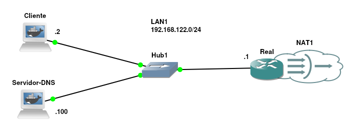

# Sistema de Nomes de Domínio (DNS)

O **DNS** (*Domain Name System* — Sistema de Nomes de Domínio) é um sistema hierárquico e distribuído de nomenclatura utilizado para identificar dispositivos, serviços e recursos conectados à Internet ou a redes privadas.

Sua função básica é atuar como uma espécie de "lista telefônica" ou agenda telefônica da rede, realizando a **resolução de nomes**: a tradução de nomes de domínio legíveis por seres humanos (como `[www.google.com](https://www.google.com)`) em endereços IP numéricos (como `142.251.153.119` em IPv4 ou `2001:4860:482d:7700::` em IPv6), que são os identificadores reais utilizados pelos protocolos de rede para localizar e rotear pacotes até o destino correto. 

Sendo assim, a forma como os computadores localizam uns aos outros passou por três grandes etapas até chegar à arquitetura de DNS que normalmente utilizamos hoje, sendo essas:

1. **Uso exclusivo de endereços IP:** Nos primórdios das redes de computadores, não havia nomes amigáveis. Para acessar um servidor ou transferir arquivos, os usuários precisavam memorizar e digitar diretamente o endereço IP numérico da máquina de destino. Embora funcional, esse método é pouco amigável e altamente propenso a erros humanos à medida que novos computadores são conectados as redes, principalmente uma rede grande tal como Internet - imagina memorizar os IPs dos principais _sites_ da rede mundial de computadores?
2. **O arquivo estático `/etc/hosts`:** Para eliminar a necessidade de decorar números, passou-se a utilizar um arquivo de texto local chamado `hosts` (localizado em `/etc/hosts` nos sistemas Linux/Unix). Esse arquivo continha uma tabela simples associando cada endereço IP a um nome. Nos tempos da ARPANET, um único arquivo mestre era mantido centralmente e copiado manualmente pelos administradores para cada computador da rede. Com o crescimento exponencial da rede, esse modelo tornou-se inviável: o arquivo ficou gigante, o tráfego para baixá-lo consumia muita banda e manter todas as máquinas sincronizadas e sem conflitos de nomes tornou-se muito complicado.
3. **Servidores DNS distribuídos:** Para resolver o gargalo do arquivo `hosts`, foi criado o DNS na década de 1980. Em vez de um único arquivo gigante replicado em todas as máquinas, a base de dados passou a ser **distribuída e hierárquica**. Cada organização ou administrador gerencia apenas os nomes do seu próprio domínio em seus servidores locais, enquanto servidores raiz e de topo encaminham as consultas pela rede global de forma automática e transparente.

É importante perceber que o uso do DNS é preferível aos outros métodos, pois:

* **Facilidade de memorização e usabilidade:** Usuários e aplicações interagem com nomes intuitivos e padronizados em vez de sequências numéricas complexas de IPv4 ou IPv6.
* **Administração centralizada:** Em uma rede local, qualquer alteração de endereço IP de um servidor (como um sistema interno, banco de dados ou impressora) precisa ser atualizada apenas uma vez no servidor DNS, refletindo imediatamente para todos os dispositivos da rede sem a necessidade de editar arquivos `/etc/hosts` máquina por máquina.
* **Flexibilidade e transparência na infraestrutura:** Permite migrar serviços para novos servidores ou endereços IP diferentes mantendo exatamente o mesmo nome de domínio para os usuários finais, evitando interrupções ou reconfigurações nos clientes.
* **Escalabilidade e desempenho:** Graças à arquitetura distribuída e ao uso intensivo de **cache** (armazenamento temporário das respostas já consultadas), o DNS suporta bilhões de consultas diárias com baixíssima latência.
* **Balanceamento de carga e redundância:** Um único nome de domínio pode apontar para múltiplos endereços IP, distribuindo o tráfego entre vários servidores ou redirecionando requisições em caso de falha de um equipamento.

> É importante perceber que o método mais utilizado atualmente, principalmente por usuários comuns é o uso de DNS, mas qualquer um dos três métodos citados anteriormente funcionam normalmente hoje em dia e dependendo a necessidade eles são melhores (fácil/simples) do que o uso de DNS.

Embora toda a comunicação na pilha de protocolos TCP/IP ocorra nativamente por meio de endereços IP, nas redes modernas o DNS exerce um papel absolutamente crítico e precisa de atenção contínua. Como os usuários e os sistemas operando quase que exclusivamente por meio de nomes de domínio, qualquer falha ou indisponibilidade no servidor DNS faz com que toda a rede pareça estar fora do ar — mesmo que a conectividade física, o roteamento e os servidores de destino estejam funcionando perfeitamente via endereço IP (não nomes). Além da disponibilidade, gerenciar um servidor DNS próprio e confiável é uma medida vital de segurança: depender de servidores DNS desconhecidos/não confiáveis expõe a rede a ataques de redirecionamento (como *DNS Spoofing* ou envenenamento de cache), nos quais um invasor manipula as respostas das consultas e ludibria os clientes, direcionando-os silenciosamente para servidores maliciosos que imitam _sites_ legítimos para roubar credenciais ou distribuir *malware*. Portanto, implantar, configurar corretamente e manter servidores DNS sob controle administrativo é indispensável para garantir tanto a continuidade operacional quanto a integridade e a segurança das comunicações nas redes atuais.

## BIND9

O BIND9 (*Berkeley Internet Name Domain*, versão 9) é o software de servidor DNS de código aberto mais utilizado, maduro e completo do mundo. Mantido atualmente pelo consórcio sem fins lucrativos ISC (*Internet Systems Consortium*), o BIND9 implementa integralmente os protocolos padrão do DNS e é capaz de atuar simultaneamente ou separadamente como **servidor autoritativo** (respondendo pelos domínios sob sua responsabilidade), **servidor recursivo/cache** (resolvendo consultas externas para clientes da rede) e **encaminhador** (*forwarder*).

A história do BIND confunde-se com a própria evolução da Internet. O projeto nasceu no início dos anos 1980 na Universidade da Califórnia, em Berkeley, desenvolvido por estudantes de pós-graduação financiados pela DARPA para o sistema operacional BSD Unix (4.3BSD), com o objetivo de substituir o antigo arquivo estático `HOSTS.TXT`.

Com o crescimento comercial da Internet na década de 1990, a manutenção do software passou por diversas mãos até que, em 1994, foi fundado o ISC para gerenciar profissionalmente o desenvolvimento do BIND, então nas versões 4 e 8. Por fim, lançado no ano 2000, o BIND 9 representou uma reescrita completa do código-fonte do zero. O propósito dessa reformulação foi eliminar vulnerabilidades históricas da versão 8, adicionar suporte nativo a multiprocessamento (SMP), implementar segurança criptográfica com **DNSSEC** e oferecer suporte pleno ao **IPv6**, tornando-se o padrão de referência adotado pela maioria das distribuições Linux.

Por sua aderência estrita aos padrões técnicos (RFCs) e alta capacidade de carga, o BIND9 é empregado em infraestruturas críticas de diversos setores. Várias instâncias dos 13 servidores raiz (*Root Servers*) da Internet utilizam o BIND9 para sustentar o topo da hierarquia global de nomes. Da mesma forma, provedores de Internet (ISPs) e operadoras de telecomunicações empregam-no tanto como servidor recursivo de grande escala para seus assinantes quanto para hospedar zonas autoritativas. Além disso, universidades, órgãos governamentais, registradores de domínios (TLDs) e empresas de todos os portes adotam o BIND9 em suas redes para resolução de nomes internos (intranets), integração com ambientes Linux/Unix e publicação de domínios institucionais.

Entre as principais vantagens de adotar o BIND9 em uma infraestrutura de rede, destacam-se:

* **Conformidade total com os padrões:** É a implementação de referência do DNS, garantindo que praticamente todo recurso novo aprovado pela IETF seja suportado rapidamente.
* **Versatilidade operacional:** Opera como servidor autoritativo, recursivo, primário (*master*), secundário (*slave*) ou híbrido em uma única instalação.
* **Segurança robusta:** Oferece suporte avançado a DNSSEC (assinatura digital de zonas), TSIG (autenticação na transferência de zonas), listas de controle de acesso (ACLs) granulares e *Response Policy Zones* (RPZ) para bloqueio de domínios maliciosos.
* **Código aberto e multiplataforma:** É gratuito, auditável e está disponível nativamente nos repositórios oficiais de praticamente todas as distribuições Linux e sistemas Unix.

Por outro lado, o administrador deve considerar algumas desvantagens inerentes ao sistema, sendo elas:

* **Curva de aprendizado acentuada:** Exige conhecimento sólido sobre a estrutura dos registros DNS e sintaxe rígida dos arquivos de zona, onde um ponto final esquecido ou um número de série não incrementado pode invalidar toda a zona.
* **Consumo de recursos:** Por ser um servidor completo e monolítico, consome mais memória RAM e CPU do que alternativas minimalistas focadas em redes muito pequenas (como o *Dnsmasq*) ou resolvedores exclusivamente recursivos (como o *Unbound*).
* **Manutenção rigorosa de segurança:** Por ser um software complexo e amplamente exposto na Internet, exige atenção constante às atualizações de segurança fornecidas pela distribuição.

### Principais Arquivos e Comandos

Em sistema Linux, tal como o Debian e derivados, toda a configuração do BIND9 fica centralizada no diretório `/etc/bind/`. Para gerenciar o serviço corretamente, é essencial conhecer os arquivos que compõem essa estrutura:

* `/etc/bind/named.conf`: É o arquivo mestre de configuração, cuja principal função é incluir os demais arquivos organizados por finalidade.
* `/etc/bind/named.conf.options`: Define as opções globais de funcionamento do _daemon_, como diretório de cache, encaminhadores, permissões de consulta, interfaces de escuta e políticas de DNSSEC.
* `/etc/bind/named.conf.local`: É o arquivo destinado às declarações das zonas locais (diretas e reversas) administradas pelo servidor.
* `/etc/bind/named.conf.default-zones`: Contém as definições das zonas padrão internas do sistema, como `localhost`, `127.in-addr.arpa` e a lista dos servidores raiz em `db.root`.
* `/etc/bind/db.<nome_da_zona>`: São os arquivos de banco de dados das zonas criados pelo administrador, contendo os registros `SOA`, `NS`, `A`, `AAAA`, `CNAME`, `MX`, `PTR`, entre outros.

Para validar alterações, controlar o serviço e diagnosticar o funcionamento do servidor no terminal, utilizam-se os seguintes comandos:

* `named-checkconf`: Verifica se há erros de sintaxe nos arquivos de configuração (`named.conf` e seus arquivos incluídos), não retornando saída se tudo estiver correto.
* `named-checkzone <zona> <arquivo>`: Valida a sintaxe e a integridade lógica de um arquivo de zona específico antes de colocá-lo em produção.
* `rndc reload` / `rndc flush`: É o utilitário de controle do daemon `named`, permitindo recarregar zonas alteradas sem derrubar o serviço (`reload`) ou limpar o cache de resolução armazenado em memória (`flush`).
* `systemctl status|restart|reload bind9`: Gerencia o ciclo de vida do serviço no Debian por meio do `systemd`.
* `dig` e `nslookup`: São ferramentas de diagnóstico utilizadas para consultar o servidor DNS e testar se os registros diretos e reversos estão respondendo conforme esperado.

### Configuração Básica (`named.conf.options`)

Dentro do bloco `options { ... };` no arquivo `/etc/bind/named.conf.options`, diversas diretivas controlam o comportamento, o desempenho e a segurança do servidor. As principais opções utilizadas em uma configuração básica são:

* **Diretório de trabalho (`directory "/var/cache/bind";`):** Define o local no sistema de arquivos onde o BIND9 armazena arquivos temporários, _dumps_ e dados persistentes de cache.
* **Controle de cache (`max-cache-size` e `max-cache-ttl`):** Determina quanta memória RAM o servidor pode reservar para armazenar respostas já consultadas (por exemplo, `max-cache-size 256M;`) e o tempo máximo que um registro permanece em cache (`max-cache-ttl`), acelerando consultas repetidas dos clientes locais e reduzindo o tráfego externo.
* **Controle de permissão de consultas (`allow-query`):** Define quais clientes ou faixas de rede têm permissão para enviar consultas ao servidor, como em `allow-query { localhost; 192.168.1.0/24; };`.
* **Controle de recursão (`allow-recursion`):** Restringe quais clientes podem solicitar que o servidor resolva nomes externos. Como boa prática de segurança, nunca se deve deixar a recursão aberta para toda a Internet, evitando que o servidor seja explorado em ataques de amplificação DDoS (*Open Resolver*).
* **Restrição de transferência de zona (`allow-transfer`):** Define quais servidores secundários podem baixar a cópia completa da zona (transferência AXFR), devendo ser configurada como `allow-transfer { none; };` quando não houver servidores secundários, o que impede que terceiros mapeiem a estrutura interna da rede.
* **Encaminhadores (`forwarders` e `forward`):** A diretiva `forwarders { 1.1.1.1; 9.9.9.9; };` especifica uma lista de servidores DNS externos confiáveis para os quais o BIND9 enviará consultas que não conhece localmente, em vez de consultar diretamente os servidores raiz da Internet. Já a opção `forward first;` (padrão) faz o servidor tentar os encaminhadores e, se falharem, resolver por conta própria, enquanto `forward only;` obriga o servidor a depender exclusivamente dos encaminhadores listados.

Portanto, o BIND9 consolidou-se como a espinha dorsal da resolução de nomes na Internet graças à sua estabilidade comprovada, conformidade rigorosa com os padrões técnicos e flexibilidade de configuração. Embora exija rigor administrativo na edição de seus arquivos e atenção constante às políticas de acesso e atualização, dominar o BIND9 proporciona ao administrador de redes controle total sobre a infraestrutura de nomes — permitindo otimizar o tráfego interno por meio de cache, integrar serviços locais com segurança e proteger os usuários contra falhas e manipulações externas na resolução de domínios.

## Configuração um Servidor DNS com BIND9

Para demonstrar na prática a implantação de um servidor DNS utilizando o BIND9, foi montado um ambiente simulado no GNS3 com contêineres Docker, conforme ilustrado na Figura 1.



A topologia representa uma rede local identificada como **LAN1**, operando sob o endereço de rede `192.168.122.0/24`. Nessa infraestrutura, todos os equipamentos estão interconectados por meio de um elemento concentrador (`Hub1`) e possuem as seguintes atribuições:

* **Servidor-DNS (`192.168.122.100`):** Contêiner Linux responsável por hospedar o serviço BIND9 e responder pelas resoluções de nomes do domínio fictício `empresa1.info`.

* **Cliente (`192.168.122.2`):** Contêiner Linux que representa uma estação de trabalho da rede local, utilizado para consumir o serviço DNS e validar as consultas diretas e reversas.

* **Real / NAT1 (`192.168.122.1`):** Interface de saída que atua como *gateway* padrão da rede local, provendo acesso externo (Internet) por meio de NAT para a instalação de pacotes e consultas externas.

### Configuração do Servidor DNS

O primeiro passo na preparação do `Servidor-DNS` consiste em configurar sua interface de rede, definir a rota padrão para acesso externo, apontar temporariamente um resolvedor público para baixar os pacotes necessários e, em seguida, instalar o pacote `bind9`. Os comandos executados no terminal do servidor são apresentados a seguir:

```bash
root@Servidor-DNS:/# ifconfig eth0 192.168.122.100
root@Servidor-DNS:/# route add default gw 192.168.122.1
root@Servidor-DNS:/# echo nameserver 8.8.8.8 > /etc/resolv.conf

root@Servidor-DNS:/# apt update
root@Servidor-DNS:/# apt install bind9

```

Na sequência de comandos anterior, o utilitário `ifconfig` atribui o endereço IP `192.168.122.100` à interface `eth0`, enquanto o comando `route add default gw` define o endereço `192.168.122.1` como rota padrão da máquina. A linha `echo nameserver 8.8.8.8 > /etc/resolv.conf` configura temporariamente o DNS público do Google para que o sistema consiga resolver os nomes dos repositórios do Debian durante a instalação. Por fim, `apt update` atualiza a lista de pacotes disponíveis e `apt install bind9` realiza a instalação do daemon `named` e seus arquivos base.

Com o serviço instalado, é necessário informar ao BIND9 quais domínios estarão sob sua responsabilidade autoritativa. Essa declaração é feita no arquivo `/etc/bind/named.conf.local`, cujo conteúdo configurado para este cenário é exibido a seguir:

```text
//
// Do any local configuration here
//

zone "empresa1.info" {
	type master;
	file "/etc/bind/db.empresa1.info";
};

zone "122.168.192.in-addr.arpa" {
	type master;
	file "/etc/bind/db.192.168.122";
};

```

Nesse arquivo foram criados dois blocos `zone`. O primeiro declara a **zona direta** para o domínio `empresa1.info`, definindo o servidor como primário (`type master;`) e indicando que seus registros estão armazenados no arquivo `/etc/bind/db.empresa1.info`. O segundo bloco declara a **zona reversa** correspondente à sub-rede `192.168.122.0/24`. Por padrão do protocolo DNS, os octetos da rede são escritos na ordem inversa seguidos do sufixo especial `.in-addr.arpa` (`122.168.192.in-addr.arpa`), apontando para o arquivo de banco de dados `/etc/bind/db.192.168.122`.


#### Criação dos Arquivos de Zona Direta e Zona Reversa

Após declarar as zonas, criam-se os respectivos arquivos contendo os registros de recursos (*Resource Records*) que mapeiam os nomes e endereços da rede. O conteúdo do arquivo da zona direta (`/etc/bind/db.empresa1.info`) e do arquivo da zona reversa (`/etc/bind/db.192.168.122`) é apresentado na sequência:

* ``/etc/bind/db.empresa1.info``:

O conteúdo deste arquivo é:

```text
$TTL    604800
@       IN      SOA     dns.empresa1.info. admin.empresa1.info. (
                              2         ; Serial (incremente a cada alteração)
                         604800         ; Refresh
                          86400         ; Retry
                        2419200         ; Expire
                         604800 )       ; Negative Cache TTL
;
@        IN      NS      dns.empresa1.info.
real	 IN      A       192.168.122.1
www      IN      A       192.168.122.2
dns 	 IN      A       192.168.122.100
webmail	 IN	 CNAME	 www

```

* `/etc/bind/db.192.168.122`:

O conteúdo da zone reversa do exemplo é:

```text
root@Servidor-DNS:/# cat /etc/bind/db.192.168.122 
$TTL    604800
@       IN      SOA    dns.empresa1.info. admin.empresa1.info. (
                              2         ; Serial
                         604800         ; Refresh
                          86400         ; Retry
                        2419200         ; Expire
                         604800 )       ; Negative Cache TTL
;
@       IN      NS      dns.empresa1.info.
1       IN      PTR     real.empresa1.info.
2       IN      PTR     www.empresa1.info.
100     IN      PTR     dns.empresa1.info.

```

Os parâmetros e tipos de registros presentes nos arquivos de zona direta e reversa possuem as seguintes funções:

* **`$TTL 604800` (*_Time To Live_*):** Define o tempo padrão (em segundos — neste caso, 7 dias) durante o qual outros servidores DNS podem manter os registros desta zona armazenados em cache antes de consultarem o servidor novamente.
* **`@`:** É um atalho sintático que representa a própria raiz do domínio declarado no `named.conf.local` (ou seja, substitui `empresa1.info.` na zona direta e `122.168.192.in-addr.arpa.` na zona reversa).
* **`IN` (*Internet*):** Especifica a classe do registro como pertencente à pilha de protocolos TCP/IP da Internet.
* **`SOA` (*_Start of Authority_*):** Registro obrigatório que marca o início da autoridade sobre a zona, informando o servidor DNS primário (`dns.empresa1.info.`), o e-mail do administrador responsável com o `@` substituído por um ponto (`admin.empresa1.info.`), e cinco temporizadores de sincronização: 
    * **Serial**: Número de versão da zona, que deve ser incrementado a cada modificação para que servidores secundários saibam que há atualizações;
    * **Refresh**: Intervalo em que o secundário verifica atualizações;
    * **Retry**: Tempo de espera para nova tentativa caso o primário não responda;
    * **Expire**: Prazo máximo em que o secundário continua respondendo pela zona se perder contato com o primário;
    * **Negative Cache TTL**: tempo de cache para respostas negativas de domínios inexistentes.
* **`NS` (*Name Server*):** Indica qual servidor DNS possui autoridade para responder pelo domínio (`dns.empresa1.info.`). Todo registro `NS` exige um registro `A` correspondente na zona direta.
* **`A` (*Address*):** Utilizado na zona direta para mapear um nome de host diretamente para um endereço IPv4 de 32 bits, como ocorre em `real` (`192.168.122.1`), `www` (`192.168.122.2`) e `dns` (`192.168.122.100`).
* **`CNAME` (*Canonical Name*):** Cria um apelido (*alias*) de um nome para outro nome já existente na zona. No exemplo, `webmail` aponta para `www`, fazendo com que ambos resolvam para o mesmo endereço IP (`192.168.122.2`).
* **`PTR` (*Pointer*):** Utilizado exclusivamente na zona reversa para fazer o mapeamento inverso, associando o último octeto do endereço IP (`1`, `2` e `100`) ao nome completo do domínio (FQDN), sempre terminado com um ponto final (`.`) para evitar que o BIND concatene o sufixo da zona ao final do nome.

Antes de iniciar o serviço, é fundamental verificar se não há erros de sintaxe nos arquivos de configuração e nas zonas criadas, e então subir o serviço conferindo se a porta padrão do DNS (UDP 53) entrou em estado de escuta. Os comandos utilizados para validação e inicialização são mostrados a seguir:

```bash
root@Servidor-DNS:/# named-checkconf 

root@Servidor-DNS:/# named-checkzone empresa1.info /etc/bind/db.empresa1.info 
zone empresa1.info/IN: loaded serial 2
OK

root@Servidor-DNS:/# named-checkzone 122.168.192.in-addr.arpa /etc/bind/db.192.168.122   
zone 122.168.192.in-addr.arpa/IN: loaded serial 2
OK
```
O comando `named-checkconf` verifica os arquivos principais do BIND9 e, por não exibir mensagens de erro, confirma que a estrutura global está válida. Em seguida, o utilitário `named-checkzone` valida individualmente os arquivos de zona direta e reversa, retornando o status `OK` e o número serial carregado (`loaded serial 2`).

Agora vamos verificar se o servidor DNS, caso não estiver vamos ligá-lo (se já estivesse iriamos religar para recarregar a configuração, isso utiliza a opção `restart`), depois disso podemos verificar se eles está em execução novamente, veja os comandos a seguir:

``` bash
root@Servidor-DNS:/# netstat -a --udp -np
Active Internet connections (servers and established)
Proto Recv-Q Send-Q Local Address           Foreign Address         State       PID/Program name    
root@Servidor-DNS:/# /etc/init.d/named start
Starting domain name service...: named.
root@Servidor-DNS:/# netstat -a --udp -np
Active Internet connections (servers and established)
Proto Recv-Q Send-Q Local Address           Foreign Address         State       PID/Program name    
udp        0      0 192.168.122.100:53      0.0.0.0:*                           678/named           
udp        0      0 127.0.0.1:53            0.0.0.0:*                           678/named           
udp6       0      0 ::1:53                  :::*                                678/named           

```

Anteriormente, para observar o comportamento das portas de rede, o comando `netstat -a --udp -np` é executado antes da inicialização, mostrando que nenhum processo escutava na porta 53. Em seguida, o serviço é iniciado por meio do script `/etc/init.d/named start`. Cabe destacar que, neste laboratório, utiliza-se o diretório `/etc/init.d/` porque o ambiente é executado sobre contêineres Docker leves no GNS3 que não rodam o gerenciador de inicialização completo do sistema; contudo, em servidores Linux tradicionais e instalações modernas do Debian, o gerenciamento do serviço é realizado padrão via `systemd` utilizando o comando `systemctl start bind9` (ou `systemctl restart bind9`). Por fim, a nova execução do `netstat` confirma que o processo `named` (PID 678) está ativo e escutando requisições DNS na porta **UDP 53** tanto na interface local (`127.0.0.1:53`) quanto no endereço da rede LAN1 (`192.168.122.100:53`).


### Configuração do Cliente e Testes

Com o servidor operacional, a etapa final consiste em configurar o host `Cliente` (`192.168.122.2`) para utilizar o `Servidor-DNS` como seu resolvedor de nomes e executar testes práticos de consulta direta e reversa. Os comandos realizados no terminal do cliente são apresentados abaixo:

```bash
root@Cliente:/# ifconfig eth0 192.168.122.2
root@Cliente:/# route add default gw 192.168.122.1
root@Cliente:/# echo nameserver 192.168.122.100 > /etc/resolv.conf

root@Cliente:/# apt update && apt install -y dnsutils

root@Cliente:/# nslookup www.empresa1.info
Server:		192.168.122.100
Address:	192.168.122.100#53

Name:	www.empresa1.info
Address: 192.168.122.2

root@Cliente:/# nslookup webmail.empresa1.info
Server:		192.168.122.100
Address:	192.168.122.100#53

webmail.empresa1.info	canonical name = www.empresa1.info.
Name:	www.empresa1.info
Address: 192.168.122.2

root@Cliente:/# nslookup 192.168.122.100
100.122.168.192.in-addr.arpa	name = dns.empresa1.info.

root@Cliente:/# ping -c 2 real.empresa1.info
PING real.empresa1.info (192.168.122.1) 56(84) bytes of data.
64 bytes from real.empresa1.info (192.168.122.1): icmp_seq=1 ttl=64 time=0.452 ms
64 bytes from real.empresa1.info (192.168.122.1): icmp_seq=2 ttl=64 time=0.389 ms

```

Nos comandos iniciais do cliente, define-se seu endereço IP (`192.168.122.2`), seu *gateway* padrão (`192.168.122.1`) e, crucialmente, aponta-se o arquivo `/etc/resolv.conf` para o IP do servidor DNS interno (`nameserver 192.168.122.100`). Após instalar o pacote `dnsutils` (que fornece ferramentas de diagnóstico DNS), executam-se os testes de validação:

* **Teste de registro `A` (`nslookup www.empresa1.info`):** Confirma que o servidor `192.168.122.100` respondeu pela porta 53 e traduziu corretamente o nome `www.empresa1.info` para o IP `192.168.122.2`.
* **Teste de registro `CNAME` (`nslookup webmail.empresa1.info`):** Demonstra o funcionamento do apelido, informando que `webmail.empresa1.info` é um nome canônico para `www.empresa1.info` e resolvendo para o mesmo IP `192.168.122.2`.
* **Teste de zona reversa (`nslookup 192.168.122.100`):** Valida o registro `PTR`, traduzindo o endereço IP `192.168.122.100` de volta para o nome `dns.empresa1.info.`.
* **Teste de conectividade por nome (`ping -c 2 real.empresa1.info`):** Comprova que o sistema operacional como um todo utiliza o servidor DNS configurado para resolver nomes em aplicações reais de rede, alcançando o *gateway* `192.168.122.1` pelo seu nome de domínio.

Desta forma, a configuração apresentada demonstra, de forma estruturada, como implantar um servidor DNS autoritativo funcional utilizando o BIND9 em ambiente Linux. Ao integrar a declaração das zonas no `named.conf.local`, o mapeamento preciso de registros `SOA`, `NS`, `A`, `CNAME` e `PTR`, a validação preventiva com `named-checkconf` e `named-checkzone` e a correta configuração do `/etc/resolv.conf` nos clientes, estabelece-se uma infraestrutura de resolução de nomes confiável e centralizada. Esse domínio técnico permite ao administrador não apenas facilitar a comunicação interna entre serviços por meio de nomes amigáveis, mas também diagnosticar rapidamente falhas de rede e garantir a integridade das consultas realizadas pelos usuários.

<!--
## Servidor DNS

root@Servidor-DNS:/# ifconfig eth0 192.168.122.100
root@Servidor-DNS:/# route add default gw 192.168.122.1
root@Servidor-DNS:/# echo nameserver 8.8.8.8 > /etc/resolv.conf


root@Servidor-DNS:/# apt update
root@Servidor-DNS:/# apt install bind9

root@Servidor-DNS:/# cat /etc/bind/named.conf.local 
//
// Do any local configuration here
//

zone "empresa1.info" {
	type master;
	file "/etc/bind/db.empresa1.info";
};

zone "122.168.192.in-addr.arpa" {
	type master;
	file "/etc/bind/db.192.168.122";
};


root@Servidor-DNS:/# cat /etc/bind/db.empresa1.info 
$TTL    604800
@       IN      SOA     dns.empresa1.info. admin.empresa.info. (
                              2         ; Serial (incremente a cada alteração)
                         604800         ; Refresh
                          86400         ; Retry
                        2419200         ; Expire
                         604800 )       ; Negative Cache TTL
;
@        IN      NS      dns.empresa.info.
real	 IN      A       192.168.122.1
www      IN      A       192.168.122.2
dns 	 IN      A       192.168.122.100
webmail	 IN	 CNAME	 www


root@Servidor-DNS:/# cat /etc/bind/db.192.168.122 
$TTL    604800
@       IN      SOA    dns.empresa1.info. admin.empresa1.info. (
                              2         ; Serial
                         604800         ; Refresh
                          86400         ; Retry
                        2419200         ; Expire
                         604800 )       ; Negative Cache TTL
;
@       IN      NS      dns.empresa1.info.
1       IN      PTR     real.empresa1.info.
2       IN      PTR     www.empresa1.info.
100     IN      PTR     dns.empresa1.info.

root@Servidor-DNS:/# named-checkconf 

root@Servidor-DNS:/# named-checkzone empresa1.info /etc/bind/db.empresa1.info 
zone empresa1.info/IN: loaded serial 2
OK

root@Servidor-DNS:/# named-checkzone 122.168.192.in-addr.arpa /etc/bind/db.192.168.122   
zone 122.168.192.in-addr.arpa/IN: loaded serial 2
OK


root@Servidor-DNS:/# netstat -a --udp -np
Active Internet connections (servers and established)
Proto Recv-Q Send-Q Local Address           Foreign Address         State       PID/Program name    
root@Servidor-DNS:/# /etc/init.d/named start
Starting domain name service...: named.
root@Servidor-DNS:/# netstat -a --udp -np
Active Internet connections (servers and established)
Proto Recv-Q Send-Q Local Address           Foreign Address         State       PID/Program name    
udp        0      0 192.168.122.100:53      0.0.0.0:*                           678/named           
udp        0      0 192.168.122.100:53      0.0.0.0:*                           678/named           
udp        0      0 192.168.122.100:53      0.0.0.0:*                           678/named           
udp        0      0 192.168.122.100:53      0.0.0.0:*                           678/named           
udp        0      0 127.0.0.1:53            0.0.0.0:*                           678/named           
udp        0      0 127.0.0.1:53            0.0.0.0:*                           678/named           
udp        0      0 127.0.0.1:53            0.0.0.0:*                           678/named           
udp        0      0 127.0.0.1:53            0.0.0.0:*                           678/named           
udp6       0      0 ::1:53                  :::*                                678/named           
udp6       0      0 ::1:53                  :::*                                678/named           
udp6       0      0 ::1:53                  :::*                                678/named           
udp6       0      0 ::1:53                  :::*                                678/named           
udp6       0      0 fe80::42:19ff:fe14:9:53 :::*                                678/named           
udp6       0      0 fe80::42:19ff:fe14:9:53 :::*                                678/named           
udp6       0      0 fe80::42:19ff:fe14:9:53 :::*                                678/named           
udp6       0      0 fe80::42:19ff:fe14:9:53 :::*                                678/named


# Cliente

root@Cliente:/# ifconfig eth0 192.168.122.2/24
root@Cliente:/# route add default gw 192.168.122.1
root@Cliente:/# echo nameserver 192.168.122.100 > /etc/resolv.conf 
root@Cliente:/# ping www.google.com.br
PING www.google.com.br (142.250.78.131) 56(84) bytes of data.
64 bytes from 142.250.78.131: icmp_seq=1 ttl=115 time=14.5 ms
64 bytes from 142.250.78.131: icmp_seq=2 ttl=115 time=14.4 ms

root@Cliente:/# nslookup www.empresa1.info 
Server:		192.168.122.100
Address:	192.168.122.100#53

Name:	www.empresa1.info
Address: 192.168.122.2

root@Cliente:/# ping webmail.empresa1.info
PING www.empresa1.info (192.168.122.2) 56(84) bytes of data.
64 bytes from www.empresa1.info (192.168.122.2): icmp_seq=1 ttl=64 time=0.018 ms
64 bytes from www.empresa1.info (192.168.122.2): icmp_seq=2 ttl=64 time=0.033 ms


root@Cliente:/# nslookup 192.168.122.1
1.122.168.192.in-addr.arpa	name = real.empresa1.info.
-->
