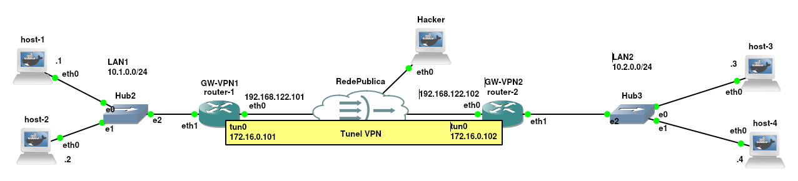

# OpenVPN

Uma **VPN (_Virtual Private Network_)** é uma tecnologia de rede que permite criar conexões seguras e criptografadas sobre uma infraestrutura pública ou não confiável, como a Internet. Então, quando somada a técnicas criptográficas a VPN tem como objetivo garantir a privacidade, a integridade dos dados e a autenticação entre redes geograficamente separadas.

O **OpenVPN** é uma das soluções de VPN de código aberto mais consolidadas e utilizadas do mercado. Criado por James Yonan, o OpenVPN utiliza protocolos de segurança baseados no OpenSSL e opera na camada de aplicação (camada 7 do modelo OSI), utilizando um _driver_ de rede virtual (TUN/TAP) para criar as interfaces de rede tuneladas.

Vantagens do OpenVPN:

* **Flexibilidade e Compatibilidade:** Funciona em diversas plataformas (Linux, Windows, macOS, Android, iOS).
* **Segurança Robusta:** Suporta algoritmos modernos de criptografia (AES, ChaCha20-Poly1305) e negociação TLS.
* **Transposição de Firewalls:** Opera nativamente via protocolo UDP ou TCP (geralmente na porta 1194), o que facilita a passagem por rotas NAT e firewalls restritivos.
* **Flexibilidade de Autenticação:** Permite o uso de chaves pré-compartilhadas, certificados digitais X.509 ou autenticação baseada em usuário/senha.

Desvantagens do OpenVPN:

* **Overhead no Espaço de Usuário:** Por rodar em modo de usuário (*user-space*), pode ter um desempenho ligeiramente inferior a soluções integradas diretamente ao kernel do Linux (como o WireGuard), embora o recurso DCO (*Data Channel Offload*) mitigue essa limitação em versões recentes.
* **Complexidade na Gestão de PKI:** A criação e a manutenção de uma Infraestrutura de Chaves Públicas (PKI/CA) tradicional para ambientes grandes exige um gerenciamento cuidadoso do ciclo de vida dos certificados.

Então, a escolha do OpenVPN por empresas e profissionais de TI deve-se à sua posição consolidada como um padrão da indústria para conectividade segura. O software combina alta segurança, através da integração nativa com a biblioteca OpenSSL e suporte a cifras modernas (como AES-256 e ChaCha20), com uma elevada flexibilidade de implantação. Por operar tanto em modo *site-to-site* (interconectando matriz e filiais) quanto *client-to-site* (acesso remoto de funcionários), o OpenVPN adapta-se a diferentes topologias de rede sem exigir mudanças na infraestrutura física. Além disso, a sua capacidade de trafegar sobre os protocolos TCP e UDP em portas customizáveis permite a travessia transparente por _firewalls_ e ambientes com NAT restrito. Por fim, por ser uma solução *open-source*, ele oferece independência de fornecedor, custo zero de licenciamento de software e auditoria constante de código pela comunidade global de segurança da informação.

# Cenário de Rede de Exemplo

Para demonstrar a implementação do OpenVPN, utilizaremos a topologia de rede apresentada na Figura 1. O cenário simula a interconexão de duas redes locais de unidades corporativas (por exemplo, Matriz e Filial) através de dois _gateways_ Linux interconectados por uma rede pública não confiável, onde há um host atacante (*Hacker*) realizando monitoramento de pacotes (*sniffing*).



Basicamente a rede de exemplo tem a seguinte configuração:

* **GW-VPN1 (`router-1`):** Gateway da LAN 1:
  * `eth0`: `192.168.122.101/24` (Interface conectada à Rede Pública);
  * `eth1`: `10.1.0.101/24` (Gateway da LAN 1);
  * `tun0`: `172.16.0.101` (Interface Virtual VPN).

* **GW-VPN2 (`router-2`):** Gateway da LAN 2:
  * `eth0`: `192.168.122.102/24` (Interface conectada à Rede Pública);
  * `eth1`: `10.2.0.102/24` (Gateway da LAN 2);
  * `tun0`: `172.16.0.102` (Interface Virtual VPN).

* **LAN 1 (`10.1.0.0/24`):**
  * `host-1`: `10.1.0.1/24` (Hospeda Servidor Web Apache2);
  * `host-2`: `10.1.0.2/24` (Hospeda Servidor FTP `vsftpd`).

* **LAN 2 (`10.2.0.0/24`):**
  * `host-3`: `10.2.0.3/24` (Cliente de testes);
  * `host-4`: `10.2.0.4/24` (Cliente de testes).

* **Rede Pública (`192.168.122.0/24`):**
  * `Hacker`: Máquina posicionada no meio da rede pública com capacidade de interceptar o tráfego que trafega entre `router-1` e `router-2`.

Nesta abordagem, a conexão VPN é estabelecida diretamente entre os dois roteadores/gateways (`router-1` e `router-2`). Os computadores das redes internas (`host-1`, `host-2`, `host-3`, `host-4`) não precisam rodar nenhum software de VPN, pois todo o tráfego destinado à rede remota é transparente e automaticamente roteado pelos gateways através da interface `tun0`.

Benefícios desta abordagem de VPN:

* **Transparência:** Nenhum software adicional precisa ser instalado nos estações de trabalho dos usuários.
* **Centralização:** Toda a política de segurança e roteamento é mantida e gerenciada exclusivamente nos gateways.

Riscos Envolvidos com essa topologia de VPN:

* **Ponto Único de Falha:** Se um dos gateways ficar fora do ar, toda a comunicação entre as unidades é interrompida.
* **Segurança do Gateway:** Se um atacante comprometer o gateway da VPN, ele ganha acesso direto a toda a sub-rede interna.


# Exemplo 1 - Configuração de VPN sem Criptografia

Neste primeiro cenário, vamos criar um túnel VPN simples sem o uso de nenhum tipo de criptografia ou autenticação. O objetivo desta etapa é entender o funcionamento básico do protocolo de tunelamento (encapsulamento de pacotes IP sobre UDP) e observar na prática os riscos associados à transmissão de dados em texto claro pela rede pública.

Essa abordagem apresenta como principal vantagem a extrema simplicidade de configuração e o baixo consumo de processamento nos roteadores; contudo, carrega como grave desvantagem e risco a ausência total de confidencialidade e integridade, permitindo que um atacante posicionado no meio da rede consiga visualizar e alterar integralmente o tráfego que circula entre as redes internas.


## Configuração do Router-1 (Gateway VPN 1)

Neste bloco, realizaremos a configuração do endereçamento IP das interfaces, a ativação do roteamento de pacotes IPv4 no kernel, o mascaramento de saída via `iptables`, a instalação do OpenVPN e a criação do arquivo de configuração do túnel limpo.

Execute os seguintes comandos no terminal do `router-1`:

```bash
root@router-1:/# ifconfig eth0 192.168.122.101
root@router-1:/# route add default gw 192.168.122.1
root@router-1:/# echo "nameserver 8.8.8.8" > /etc/resolv.conf
root@router-1:/# ifconfig eth1 10.1.0.101/24
root@router-1:/# echo 1 > /proc/sys/net/ipv4/ip_forward
root@router-1:/# iptables -t nat -A POSTROUTING -o eth0 -j MASQUERADE

root@router-1:/# apt update
root@router-1:/# apt install -y openvpn

root@router-1:/# cd /etc/openvpn/
root@router-1:/etc/openvpn# vi openvpn-v1.conf
```

O conteúdo do arquivo `openvpn-v1.conf` de configuração deve ser:

```bash
dev tun
ifconfig 172.16.0.101 172.16.0.102
route 10.2.0.0 255.255.255.0
```

Explicando o arquivo de configuração `/etc/openvpn/openvpn-v1.conf`:
* `dev tun`: Cria uma interface de túnel virtual de camada 3 (roteamento de pacotes IP).
* `ifconfig 172.16.0.101 172.16.0.102`: Define o IP local da interface VPN como `172.16.0.101` e o IP remoto (do destino) como `172.16.0.102`.
* `route 10.2.0.0 255.255.255.0`: Adiciona uma rota automática no sistema operacional direcionando todo o tráfego da rede remota `10.2.0.0/24` para dentro do túnel VPN.

Em seguida, iniciamos o serviço OpenVPN no `router-1`:

```bash
root@router-1:/etc/openvpn# openvpn --config openvpn-v1.conf 
2026-11-05 01:50:59 DEPRECATION: No tls-client or tls-server option in configuration detected. OpenVPN 2.7 will remove the functionality to run a VPN without TLS. See the examples section in the manual page for examples of a similar quick setup with peer-fingerprint.
2026-11-05 01:50:59 OpenVPN 2.6.14 x86_64-pc-linux-gnu [SSL (OpenSSL)] [LZO] [LZ4] [EPOLL] [PKCS11] [MH/PKTINFO] [AEAD] [DCO]
2026-11-05 01:50:59 library versions: OpenSSL 3.5.7 9 Jun 2026, LZO 2.10
2026-11-05 01:50:59 DCO version: N/A
2026-11-05 01:50:59 ******* WARNING *******: '--cipher none' was specified. This means NO encryption will be performed and tunnelled data WILL be transmitted in clear text over the network! PLEASE DO RECONSIDER THIS SETTING!
2026-11-05 01:50:59 ******* WARNING *******: '--auth none' was specified. This means no authentication will be performed on received packets, meaning you CANNOT trust that the data received by the remote side have NOT been manipulated. PLEASE DO RECONSIDER THIS SETTING!
2026-11-05 01:50:59 ******* WARNING *******: All encryption and authentication features disabled -- All data will be tunnelled as clear text and will not be protected against man-in-the-middle changes. PLEASE DO RECONSIDER THIS CONFIGURATION!
2026-11-05 01:50:59 TUN/TAP device tun0 opened
2026-11-05 01:50:59 net_iface_mtu_set: mtu 1500 for tun0
2026-11-05 01:50:59 net_iface_up: set tun0 up
2026-11-05 01:50:59 net_addr_ptp_v4_add: 172.16.0.101 peer 172.16.0.102 dev tun0
2026-11-05 01:50:59 Could not determine IPv4/IPv6 protocol. Using AF_INET
2026-11-05 01:50:59 UDPv4 link local (bound): [AF_INET][undef]:1194
2026-11-05 01:50:59 UDPv4 link remote: [AF_UNSPEC]
```

Como observado na saída do comando, o OpenVPN emite avisos severos de alerta (*WARNING*) informando que a conexão não possui criptografia nem autenticação ativas e que os dados trafegarão em texto claro.


## Configuração do Host-1

No `host-1`, realizaremos a configuração do endereço de rede `10.1.0.1/24` apontando a rota padrão para o `router-1`. Em seguida, instalaremos o servidor web Apache2 e criaremos uma página HTML simples contendo uma senha secreta (`123mudar`) para simular um sistema interno corporativo.

Execute no terminal do `host-1`:

```bash
root@host-1:/# ifconfig eth0 10.1.0.1/24
root@host-1:/# route add default gw 10.1.0.101
root@host-1:/# echo nameserver 8.8.8.8 > /etc/resolv.conf 

root@host-1:/# apt update
root@host-1:/# apt install -y apache2
root@host-1:/# echo "Sistema secreto - senha 123mudar" > /var/www/html/index.html 
root@host-1:/# apachectl start
```

A configuração do `host-1` foi finalizada e o servidor web está pronto e escutando requisições na porta HTTP (80).


## Configuração do Host-2

De forma análoga ao `host-1`, configuramos a rede do `host-2` no IP `10.1.0.2/24` com o gateway `10.1.0.101`. Instala-se o servidor FTP (`vsftpd`), inicia-se o serviço e cria-se um usuário do sistema chamado `teste` para realização dos testes de login via rede.

Execute no terminal do `host-2`:

```bash
root@host-2:/# ifconfig eth0 10.1.0.2/24
root@host-2:/# route add default gw 10.1.0.101
root@host-2:/# echo nameserver 8.8.8.8 > /etc/resolv.conf

root@host-2:/# apt update
root@host-2:/# apt install -y vsftpd
root@host-2:/# /etc/init.d/vsftpd start
Starting FTP server: vsftpd.

root@host-2:/# adduser teste       
New password: 
Retype new password: 
passwd: password updated successfully
Changing the user information for teste
Enter the new value, or press ENTER for the default
	Full Name []: 
	Room Number []: 
	Work Phone []: 
	Home Phone []: 
	Other []: 
Is the information correct? [Y/n] 
```

O servidor FTP do `host-2` está configurado e operacional para aceitar conexões na LAN 1.


## Configuração do Router-2 (Gateway VPN 2)

Agora iremos configurar o `router-2` (gateway da LAN 2). Além de definir as interfaces de rede e a rota padrão, instalaremos o OpenVPN e criaremos o arquivo `openvpn-v1.conf`. Diferente do servidor (`router-1`), o cliente precisa conter a diretiva `remote` apontando para o IP público do servidor (`192.168.122.101`), além de inverter a ordem dos IPs no parâmetro `ifconfig`.

Execute os comandos no terminal do `router-2`:

```bash
root@router-2:/# ifconfig eth0 192.168.122.102
root@router-2:/# route add default gw 192.168.122.1
root@router-2:/# echo nameserver 8.8.8.8 > /etc/resolv.conf 
root@router-2:/# ifconfig eth1 10.2.0.102/24
root@router-2:/# echo 1 > /proc/sys/net/ipv4/ip_forward

root@router-2:/# apt update
root@router-2:/# apt install -y openvpn

root@router-2:/# cd /etc/openvpn/ 
```

então o conteúdo do arquivo `openvpn-v1.conf`, deve ser:

```bash
root@router-2:/etc/openvpn# vi openvpn-v1.conf 
remote 192.168.122.101
dev tun
ifconfig 172.16.0.102 172.16.0.101
route 10.1.0.0 255.255.255.0
```

A principal diferença do arquivo do Router-1 é o `remote`, que indica o IP "público" do Router-1, que é o servidor e a ordem dos IPs no `ifconfig`, que é o inverso do arquivo do Router-1. Com o arquivo pronto podemos iniciar a VPN no Router-2:

```bash
root@router-2:/etc/openvpn# openvpn --config openvpn-v1.conf         
2026-11-05 01:52:19 DEPRECATION: No tls-client or tls-server option in configuration detected. OpenVPN 2.7 will remove the functionality to run a VPN without TLS. See the examples section in the manual page for examples of a similar quick setup with peer-fingerprint.
2026-11-05 01:52:19 OpenVPN 2.6.14 x86_64-pc-linux-gnu [SSL (OpenSSL)] [LZO] [LZ4] [EPOLL] [PKCS11] [MH/PKTINFO] [AEAD] [DCO]
2026-11-05 01:52:19 library versions: OpenSSL 3.5.7 9 Jun 2026, LZO 2.10
2026-11-05 01:52:19 DCO version: N/A
2026-11-05 01:52:19 ******* WARNING *******: '--cipher none' was specified. This means NO encryption will be performed and tunnelled data WILL be transmitted in clear text over the network! PLEASE DO RECONSIDER THIS SETTING!
2026-11-05 01:52:19 ******* WARNING *******: '--auth none' was specified. This means no authentication will be performed on received packets, meaning you CANNOT trust that the data received by the remote side have NOT been manipulated. PLEASE DO RECONSIDER THIS SETTING!
2026-11-05 01:52:19 ******* WARNING *******: All encryption and authentication features disabled -- All data will be tunnelled as clear text and will not be protected against man-in-the-middle changes. PLEASE DO RECONSIDER THIS CONFIGURATION!
2026-11-05 01:52:19 TUN/TAP device tun0 opened
2026-11-05 01:52:19 net_iface_mtu_set: mtu 1500 for tun0
2026-11-05 01:52:19 net_iface_up: set tun0 up
2026-11-05 01:52:19 net_addr_ptp_v4_add: 172.16.0.102 peer 172.16.0.101 dev tun0
2026-11-05 01:52:19 TCP/UDP: Preserving recently used remote address: [AF_INET]192.168.122.101:1194
2026-11-05 02:52:19 UDPv4 link local (bound): [AF_INET][undef]:1194
2026-11-05 01:52:19 UDPv4 link remote: [AF_INET]192.168.122.101:1194
2026-11-05 01:52:20 Peer Connection Initiated with [AF_INET]192.168.122.101:1194
2026-11-05 01:52:20 Initialization Sequence Completed
```

A mensagem `Initialization Sequence Completed` confirma que o túnel não criptografado foi estabelecido com sucesso entre os dois gateways.


## Testes a partir do Host-3

Com o túnel estabelecido, vamos configurar a rede no `host-3` (pertencente à LAN 2) e realizar testes de conectividade e acesso ao serviço web do `host-1` (localizado na LAN 1). 

É importante destacar que **o `host-3` só consegue alcançar o IP privado `10.1.0.1` devido à existência do túnel VPN**. Sem a VPN, a rede pública `192.168.122.0/24` desconheceria as rotas para as sub-redes privadas `10.1.0.0/24` e `10.2.0.0/24`, tornando o tráfego inacessível.

Execute os comandos no terminal do `host-3`:

```bash
root@host-3:/# ifconfig eth0 10.2.0.3/24
root@host-3:/# route add default gw 10.2.0.102
root@host-3:/# echo nameserver 8.8.8.8 > /etc/resolv.conf 

root@host-3:/# cd ~
root@host-3:~# ls -l
total 0

root@host-3:~# ping 192.168.122.101
PING 192.168.122.101 (192.168.122.101) 56(84) bytes of data.
64 bytes from 192.168.122.101: icmp_seq=1 ttl=63 time=0.632 ms
64 bytes from 192.168.122.101: icmp_seq=2 ttl=63 time=0.441 ms

root@host-3:~# ping 172.16.0.101
PING 172.16.0.101 (172.16.0.101) 56(84) bytes of data.
64 bytes from 172.16.0.101: icmp_seq=1 ttl=63 time=1.74 ms
64 bytes from 172.16.0.101: icmp_seq=2 ttl=63 time=0.583 ms
64 bytes from 172.16.0.101: icmp_seq=3 ttl=63 time=0.914 ms
64 bytes from 172.16.0.101: icmp_seq=4 ttl=63 time=1.51 ms
64 bytes from 172.16.0.101: icmp_seq=5 ttl=63 time=1.30 ms

root@host-3:~# wget http://10.1.0.1
--2026-11-05 02:00:54--  http://10.1.0.1/
Connecting to 10.1.0.1:80... connected.
HTTP request sent, awaiting response... 200 OK
Length: 33 [text/html]
Saving to: 'index.html'

index.html                        100%[============================================================>]      33  --.-KB/s    in 0s      

2026-11-05 02:00:54 (4.36 MB/s) - 'index.html' saved [33/33]

root@host-3:~# ls 
index.html
root@host-3:~# cat index.html 
Sistema secreto - senha 123mudar
```

O teste confirma que o tráfego navegou da LAN 2 até a LAN 1 via túnel VPN e baixou o arquivo contendo a informação confidencial.


## Testes a partir do Host-4

Configuramos agora o `host-4` (também na LAN 2) para realizar testes de validação do alcance ICMP (ping) para os dois servidores da LAN 1 (`host-1` e `host-2`).

Execute os comandos no terminal do `host-4`:

```bash
root@host-4:/# ifconfig eth0 10.2.0.4/24
root@host-4:/# route add default gw 10.2.0.102
root@host-4:/# echo nameserver 8.8.8.8 > /etc/resolv.conf 
root@host-4:/# ping 10.1.0.1 -c 1
PING 10.1.0.1 (10.1.0.1) 56(84) bytes of data.
64 bytes from 10.1.0.1: icmp_seq=1 ttl=62 time=1.39 ms

--- 10.1.0.1 ping statistics ---
1 packets transmitted, 1 received, 0% packet loss, time 0ms
rtt min/avg/max/mdev = 1.391/1.391/1.391/0.000 ms
root@host-4:/# ping 10.1.0.2 -c 1
PING 10.1.0.2 (10.1.0.2) 56(84) bytes of data.
64 bytes from 10.1.0.2: icmp_seq=1 ttl=62 time=1.23 ms

--- 10.1.0.2 ping statistics ---
1 packets transmitted, 1 received, 0% packet loss, time 0ms
rtt min/avg/max/mdev = 1.229/1.229/1.229/0.000 ms
```

Com o roteamento validado, os dois lados da rede comunicam-se perfeitamente.


## Captura de Tráfego no Host Hacker (Ataque no Exemplo 1)

Agora analisaremos a perspectiva da segurança. A máquina `Hacker` está posicionada na rede pública intermediária e irá executar o utilitário `tcpdump` para interceptar os pacotes transmitidos pela rede.

### Teste 1: Filtrando a porta 80 tradicional
O hacker tenta filtrar pacotes na porta 80 para capturar requisições HTTP diretas:

```bash
root@Hacker:/# tcpdump -i eth0 -nX port 80
tcpdump: verbose output suppressed, use -v[v]... for full protocol decode
listening on eth0, link-type EN10MB (Ethernet), snapshot length 262144 bytes
```
*Explicação:* O resultado é vazio, pois o tráfego HTTP está encapsulado dentro dos pacotes UDP do OpenVPN.

### Teste 2: Capturando na porta 1194 do OpenVPN
O hacker altera o filtro do `tcpdump` para inspecionar os pacotes UDP na porta 1194 (OpenVPN):

```bash
02:06:08.262503 IP 192.168.122.101.1194 > 192.168.122.102.1194: UDP, length 368
	0x0000:  4500 018c a1f9 4000 4011 214b c0a8 7a65  E.....@.@.!K..ze
	0x0010:  c0a8 7a66 04aa 04aa 0178 92f7 4500 0170  ..zf.....x..E..p
	0x0020:  3836 4000 3f06 ee4a 0a01 0001 0a02 0004  86@.?..J........
	0x0030:  0050 b648 2b95 f732 45fb a2c3 8018 0040  .P.H+..2E......@
	0x0040:  8ce3 0000 0101 080a 0e2b c016 25f2 8b1a  .........+..%...
	0x0050:  4854 5450 2f31 2e31 2032 3030 204f 4b0d  HTTP/1.1.200.OK.
	0x0060:  0a44 6174 653a 2054 6875 2c20 3035 204e  .Date:.Thu,.05.N
	0x0070:  6f76 2032 3032 3620 3032 3a30 363a 3038  ov.2026.02:06:08
	0x0080:  2047 4d54 0d0a 5365 7276 6572 3a20 4170  .GMT..Server:.Ap
	0x0090:  6163 6865 2f32 2e34 2e36 3920 2844 6562  ian)..Last-Modif
	0x00b0:  6961 6e29 0d0a 4c61 7374 2d4d 6f64 6966  ied:.Thu,.05.Nov
	0x00c0:  2032 3032 3620 3031 3a34 323a 3030 204g  .2026.01:42:00.G
	0x0160:  7478 742f 6874 6d6c 0d0a 0d0a 5365 7274  xt/html....Siste
	0x0170:  6d61 2073 6563 7265 746f 202d 2073 656e  ma.secreto.-.sen
	0x0180:  6861 2031 3233 6d75 6461 720a            ha.123mudar.
```

Para extrair os dados em formato ASCII legível e filtrar a linha contendo a senha, o atacante executa:

```bash
root@Hacker:/# tcpdump -i eth0 -nA -l port 1194 | grep --line-buffered '123mudar'
tcpdump: verbose output suppressed, use -v[v]... for full protocol decode
listening on eth0, link-type EN10MB (Ethernet), snapshot length 262144 bytes
Sistema secreto - senha 123mudar
```

No `tcpdump` a opção `-A` exibe os pacotes em ASCII, `-nA` desativa a resolução de nomes e IPs para aumentar o desempenho, e o `-l` força o *buffer* de linha para repassar o fluxo instantaneamente ao `grep`.

Sendo assim, observando a sadia anterior, é possível concluir no teste com HTTP que mensagem "Sistema secreto - senha 123mudar" aparece completamente limpa na tela do atacante, ou seja, o atacante teve sucesso no ataque.

### Teste 3: Capturando credenciais de uma sessão FTP

Em seguida, quando uma conexão FTP é realizada entre a LAN 2 e o `host-2` (`10.1.0.2`), o atacante observa a negociação de autenticação no `tcpdump`:

```bash
02:08:37.132477 IP 192.168.122.102.1194 > 192.168.122.101.1194: UDP, length 64
	0x0050:  5553 4552 2074 6573 7465 0d0a            USER.teste..

02:08:40.352700 IP 192.168.122.102.1194 > 192.168.122.101.1194: UDP, length 67
	0x0050:  5041 5353 2069 6c6f 7665 796f 750d 0a    PASS.iloveyou..
```

Tal como no HTTP, no FTP o comando `USER teste` e a senha em texto claro `PASS iloveyou` foram totalmente expostos ao atacante.


# Exemplo 2 - VPN com Chave Única (Chave Estática Pré-Compartilhada)

Para corrigir a vulnerabilidade crítica de exposição dos dados observada no Exemplo 1, implementaremos o uso de **criptografia simétrica** utilizando uma **Chave Estática Pré-Compartilhada (`static.key`)**.

A criptografia transforma a informação original (texto claro) em uma representação ilegível (texto cifrado) por meio de algoritmos matemáticos complexos (como o AES). Mesmo que o atacante capture os pacotes na rede pública, ele não conseguirá interpretar ou alterar seu conteúdo sem possuir a chave de descriptografia.

Apesar de sua extrema simplicidade, o modo de chave estática pré-compartilhada (`--secret`) do OpenVPN **foi descontinuado e será completamente removido a partir da versão 2.7 do OpenVPN** pelos seguintes motivos:

1. **Ausência de Forward Secrecy (PFS):** Se a chave `static.key` for vazada no futuro, **todo** o histórico de tráfego capturado no passado poderá ser descriptografado retroativamente.
2. **Sem Autenticação Dinâmica ou Revogação:** Não é possível revogar o acesso de um único nó sem ter que gerar e redistribuir manualmente uma nova chave para todas as máquinas do ambiente.
3. **Uso de Cifras Antigas:** Por padrão, o modo estático tentava utilizar a cifra `BF-CBC` (Blowfish), considerada obsoleta e vulnerável a ataques do tipo *SWEET32*.

Mesmo assim, vamos utilizar essa configuração neste exemplo, já que é uma configuração muito utilizada no OpenVPN (sistemas legados) e interessante por motivos didáticos.

## Configuração do Router-1 (Com Chave Estática)

No `router-1`, geramos a chave secreta de 2048 bits com o comando `openvpn --genkey secret static.key`, criamos o arquivo de configuração `openvpn-v2.conf` especificando a cifra de criptografia `AES-256-CBC` e a chave criada, e iniciamos a VPN.

Execute os comandos no terminal do `router-1`:

```bash
root@router-1:/etc/openvpn# openvpn --genkey secret static.key
root@router-1:/etc/openvpn# cat static.key 
#
# 2048 bit OpenVPN static key
#
-----BEGIN OpenVPN Static key V1-----
5454f151b4ae363e6eae28e631a1c793
1a58a5b71eed9640c89e91c665fb9437
1b6c846016043c1834dfdba94656bb10
e663598df5403bcf2a637e93f84ca479
2b5cc5ede6f18499c30069f02d1f67d4
8a807cd97b281df7dd9c3908a1402b2e
7c5b3fe12c850f487167927cc418e609
4ad361432d487537358cfa4a4811497d
a6cf754feecca4920c4719e3103ebc6b
52a042ff6f2eada8708827c2abf471c2
ebc09b669dedf6958be5b16211ef1264
0de1e8aad5b8e0102773d715815dc1db
78855c11310ce964451b17587d37ee27
84c74eb0cde1c46acce42ec31e732cbe
259a0be9b0646fe2793bf9628769cdba
dd00fe03b344aab971e0e45851275c17
-----END OpenVPN Static key V1-----

root@router-1:/etc/openvpn# cp openvpn-v1.conf openvpn-v2.conf 

root@router-1:/etc/openvpn# cat openvpn-v2.conf 
dev tun
ifconfig 172.16.0.101 172.16.0.102
secret static.key
cipher AES-256-CBC
dh none
route 10.2.0.0 255.255.255.0

root@router-1:/etc/openvpn# openvpn --config openvpn-v2.conf
```

A chave foi gerada e o serviço iniciou aplicando a criptografia AES-256 no túnel.


## Configuração do Router-2 (Com Chave Estática)

A chave `static.key` gerada no `router-1` deve ser copiada de forma segura (ex: via SCP) para o `router-2`. Em seguida, cria-se o arquivo `openvpn-v2.conf` correspondente e inicia-se o serviço.

Execute os comandos no terminal do `router-2`:

```bash
root@router-2:/etc/openvpn# cat static.key 
#
# 2048 bit OpenVPN static key
#
-----BEGIN OpenVPN Static key V1-----
5454f151b4ae363e6eae28e631a1c793
1a58a5b71eed9640c89e91c665fb9437
1b6c846016043c1834dfdba94656bb10
e663598df5403bcf2a637e93f84ca479
2b5cc5ede6f18499c30069f02d1f67d4
8a807cd97b281df7dd9c3908a1402b2e
7c5b3fe12c850f487167927cc418e609
4ad361432d487537358cfa4a4811497d
a6cf754feecca4920c4719e3103ebc6b
52a042ff6f2eada8708827c2abf471c2
ebc09b669dedf6958be5b16211ef1264
0de1e8aad5b8e0102773d715815dc1db
78855c11310ce964451b17587d37ee27
84c74eb0cde1c46acce42ec31e732cbe
259a0be9b0646fe2793bf9628769cdba
dd00fe03b344aab971e0e45851275c17
-----END OpenVPN Static key V1-----

root@router-2:/etc/openvpn# cp openvpn-v1.conf openvpn-v2.conf 

root@router-2:/etc/openvpn# vi openvpn-v2.conf 
remote 192.168.122.101
dev tun
ifconfig 172.16.0.102 172.16.0.101
secret static.key
cipher AES-256-CBC
route 10.1.0.0 255.255.255.0

root@router-2:/etc/openvpn# openvpn --config openvpn-v2.conf
```

Com ambas as instâncias ativas, o túnel criptografado está estabelecido.


## Teste de Captura no Host Hacker (Validação da Criptografia no Exemplo 2)

Com a VPN criptografada em funcionamento, novos acessos ao servidor web e novos pings são realizados a partir da LAN 2. A máquina `Hacker` executa o mesmo comando de interceptação em busca da senha:

```bash
root@Hacker:/# tcpdump -i eth0 -nA -l port 1194 | grep --line-buffered '123mudar'
tcpdump: verbose output suppressed, use -v[v]... for full protocol decode
listening on eth0, link-type EN10MB (Ethernet), snapshot length 262144 bytes
```

*Resultado e Conclusão:* O comando não exibe **nenhum resultado**. Todo o payload transmitido pela porta 1194 encontra-se codificado em algoritmos AES-256, impedindo a leitura das informações confidenciais pelo atacante.

# Exemplo 3 - VPN Utilizando Certificados e Peer Fingerprint (Modo TLS Moderno)

A solução definitiva e moderna recomendada pelo OpenVPN para conexões ponto-a-ponto enxutas é o uso da autenticação TLS com verificação por **Peer Fingerprint (SHA-256)**. 

Por que esta abordagem é superior às anteriores?

1. **Segurança TLS Completa:** Habilita a negociação dinâmica de chaves de sessão via TLS 1.2/1.3 com **Perfect Forward Secrecy (PFS)**. Se uma chave privada vazar no futuro, o tráfego passado continuará protegido.
2. **Sem Necessidade de PKI Completa:** Não exige a criação e manutenção de uma Autoridade Certificadora (CA) complexa; utiliza certificados autoassinados leves gerados em segundos via `openssl`.
3. **Conformidade com Versões Recentes:** Elimina todos os avisos de depreciação do OpenVPN 2.6+ e garante compatibilidade com o futuro OpenVPN 2.7+.

## Configuração no Router-1

No `router-1`, geramos um certificado autoassinado X.509 de 2048 bits com validade de 10 anos via OpenSSL e extraímos o seu hash único (SHA-256 Fingerprint).

Execute os comandos no terminal do `router-1`:

```bash
root@router-1:/etc/openvpn# openssl req -x509 -newkey rsa:2048 -keyout cert.key -out cert.crt -nodes -days 3650 -subj "/CN=vpn-node"
.....+...+...+....+.....+.+..............+...+............+...+.+..+..........+..+.......

root@router-1:/etc/openvpn# openssl x509 -in cert.crt -noout -fingerprint -sha256
sha256 Fingerprint=50:51:64:54:85:06:A0:8F:5C:2B:35:D3:8E:85:2E:49:CF:71:6A:20:C1:DD:99:03:A5:3E:69:8D:BB:41:1B:AE
```

O hash do certificado do `router-1` é `50:51:64:54:85:06:A0:8F:5C:2B:35:D3:8E:85:2E:49:CF:71:6A:20:C1:DD:99:03:A5:3E:69:8D:BB:41:1B:AE`. Este valor deverá ser inserido no arquivo de configuração do cliente (`router-2`).

## Configuração no Router-2

No `router-2`, realizamos exatamente o mesmo procedimento para gerar o seu próprio certificado autoassinado e obter a sua respetiva impressão digital SHA-256.

Execute os comandos no terminal do `router-2`:

```bash
root@router-2:/etc/openvpn# openssl req -x509 -newkey rsa:2048 -keyout cert.key -out cert.crt -nodes -days 3650 -subj "/CN=vpn-node"
.+.....+...+.......+..+...+.+...........+...+.............+..............+....+.....+.......

root@router-2:/etc/openvpn# openssl x509 -in cert.crt -noout -fingerprint -sha256
sha256 Fingerprint=F7:BD:61:11:CB:B4:50:2F:44:BF:2D:15:E4:1B:67:59:79:0C:BC:1C:74:52:A0:C6:72:FB:9E:55:75:45:B7:30
```

O hash do certificado do `router-2` é `F7:BD:61:11:CB:B4:50:2F:44:BF:2D:15:E4:1B:67:59:79:0C:BC:1C:74:52:A0:C6:72:FB:9E:55:75:45:B7:30`. Este valor será configurado no lado do servidor (`router-1`).

## Criação do Arquivo de Configuração do Router-1 (`server.conf`)

Criamos o arquivo `openvpn-v3.conf` no `router-1`. Inserimos a diretiva `tls-server`, a instrução `dh none` (para dispensar arquivos DH legados) e a chave `peer-fingerprint` contendo a impressão digital do `router-2`.

Execute os comandos no terminal do `router-1`:

```bash
root@router-1:/etc/openvpn# cp openvpn-v1.conf openvpn-v3.conf

root@router-1:/etc/openvpn# vi openvpn-v3.conf 
dev tun
ifconfig 172.16.0.101 172.16.0.102
tls-server
dh none
cert cert.crt
key cert.key
peer-fingerprint "F7:BD:61:11:CB:B4:50:2F:44:BF:2D:15:E4:1B:67:59:79:0C:BC:1C:74:52:A0:C6:72:FB:9E:55:75:45:B7:30"
route 10.2.0.0 255.255.255.0

root@router-1:/etc/openvpn# openvpn --config openvpn-v3.conf
```

O servidor iniciou o escutador TLS e está pronto para validar o aperto de mão com o cliente autorizando o fingerprint específico.

## Criação do Arquivo de Configuração do Router-2 (`client.conf`) e Execução

No `router-2`, configuramos o arquivo `openvpn-v3.conf` utilizando a instrução `tls-client`, apontando para a chave `peer-fingerprint` do `router-1`, e iniciamos a conexão.

Execute os comandos no terminal do `router-2`:

```bash
root@router-2:/etc/openvpn# cp openvpn-v1.conf openvpn-v3.conf

root@router-2:/etc/openvpn# vi openvpn-v3.conf 
remote 192.168.122.101
dev tun
ifconfig 172.16.0.102 172.16.0.101
tls-client
dh none
cert cert.crt
key cert.key
peer-fingerprint "50:51:64:54:85:06:A0:8F:5C:2B:35:D3:8E:85:2E:49:CF:71:6A:20:C1:DD:99:03:A5:3E:69:8D:BB:41:1B:AE"
route 10.1.0.0 255.255.255.0

root@router-2:/etc/openvpn# openvpn --config openvpn-v3.conf
2026-11-05 02:38:08 WARNING: Ignoring option 'dh' in tls-client mode, please only include this in your server configuration
2026-11-05 02:38:08 Using certificate fingerprint to verify peer (no CA option set). 
2026-11-05 02:38:08 OpenVPN 2.6.14 x86_64-pc-linux-gnu [SSL (OpenSSL)] [LZO] [LZ4] [EPOLL] [PKCS11] [MH/PKTINFO] [AEAD] [DCO]
2026-11-05 02:38:08 library versions: OpenSSL 3.5.7 9 Jun 2026, LZO 2.10
2026-11-05 02:38:08 DCO version: N/A
2026-11-05 02:38:08 TUN/TAP device tun0 opened
2026-11-05 02:38:08 net_iface_mtu_set: mtu 1500 for tun0
2026-11-05 02:38:08 net_iface_up: set tun0 up
2026-11-05 02:38:08 net_addr_ptp_v4_add: 172.16.0.102 peer 172.16.0.101 dev tun0
2026-11-05 02:38:08 TCP/UDP: Preserving recently used remote address: [AF_INET]192.168.122.101:1194
2026-11-05 02:38:08 UDPv4 link local (bound): [AF_INET][undef]:1194
2026-11-05 02:38:08 UDPv4 link remote: [AF_INET]192.168.122.101:1194
2026-11-05 02:38:08 peer info: IV_CIPHERS=AES-256-GCM:AES-128-GCM:CHACHA20-POLY1305
2026-11-05 02:38:08 peer info: IV_PROTO=746
2026-11-05 02:38:08 [vpn-node] Peer Connection Initiated with [AF_INET]192.168.122.101:1194
2026-11-05 02:38:09 Initialization Sequence Completed
```

### Conclusão

O log confirma o encerramento da sequência de inicialização com sucesso (`Initialization Sequence Completed`), operando com negociação dinâmica de cifras modernas como `AES-256-GCM` e `CHACHA20-POLY1305`. 

Esta configuração representa a melhor prática para conexões VPN ponto-a-ponto no OpenVPN moderno, unindo a máxima segurança do protocolo TLS/AEAD à praticidade de um setup limpo e sem avisos de depreciação.
